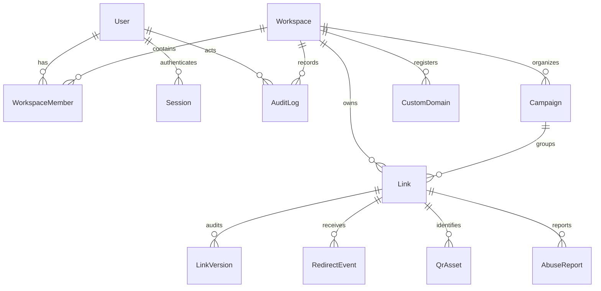

# LinkWay — Database Design & Schema Specification

**Document Version:** 1.0  
**ORM:** Prisma ORM  
**Target Engines:** PostgreSQL (Neon Serverless) & SQLite (Local Development)  
**Date:** November 2026  

---

## 1. Relational Entity Overview

---

## 2. Table Definitions & Field Types

### A. Authentication & User Management

#### `User`
- `id` (String, Primary Key, CUID)
- `email` (String, Unique)
- `passwordHash` (String, bcrypt)
- `name` (String, Optional)
- `createdAt` (DateTime, default now)
- `updatedAt` (DateTime, updated)

#### `Session`
- `id` (String, Primary Key, CUID)
- `userId` (String, Foreign Key -> User.id)
- `token` (String, Unique)
- `expiresAt` (DateTime)
- `createdAt` (DateTime, default now)

### B. Tenancy & Workspaces

#### `Workspace`
- `id` (String, Primary Key, CUID)
- `name` (String)
- `slug` (String, Unique)
- `createdAt` (DateTime, default now)
- `updatedAt` (DateTime, updated)

#### `WorkspaceMember`
- `id` (String, Primary Key, CUID)
- `workspaceId` (String, Foreign Key -> Workspace.id)
- `userId` (String, Foreign Key -> User.id)
- `role` (Enum: `OWNER`, `ADMIN`, `EDITOR`, `VIEWER`)
- `createdAt` (DateTime, default now)
- *Constraint:* Unique composite index on `[workspaceId, userId]`.

### C. Links & Campaigns

#### `Campaign`
- `id` (String, Primary Key, CUID)
- `workspaceId` (String, Foreign Key -> Workspace.id)
- `name` (String)
- `description` (String, Optional)
- `channel` (String, Optional, e.g. "Social", "Email", "Paid Search")
- `utmSource` (String, Optional)
- `utmMedium` (String, Optional)
- `createdAt` (DateTime, default now)
- `updatedAt` (DateTime, updated)

#### `Link`
- `id` (String, Primary Key, CUID)
- `workspaceId` (String, Foreign Key -> Workspace.id)
- `campaignId` (String, Optional, Foreign Key -> Campaign.id)
- `code` (String, Unique) — The short slug (e.g. `launch2026`)
- `title` (String, Optional)
- `destinationUrl` (String, VarChar 2048)
- `status` (Enum: `ACTIVE`, `PAUSED`, `ARCHIVED`, `DELETED`)
- `redirectCode` (Int, default 302)
- `expiresAt` (DateTime, Optional)
- `createdAt` (DateTime, default now)
- `updatedAt` (DateTime, updated)
- *Indexes:* `[workspaceId, status]`, `[code]`, `[campaignId]`.

#### `LinkVersion` (Immutable History Ledger)
- `id` (String, Primary Key, CUID)
- `linkId` (String, Foreign Key -> Link.id)
- `versionNumber` (Int)
- `destinationUrl` (String, VarChar 2048)
- `title` (String, Optional)
- `changeReason` (String, Optional)
- `actorUserId` (String, Optional)
- `createdAt` (DateTime, default now)
- *Constraint:* Unique composite on `[linkId, versionNumber]`.

#### `QrAsset`
- `id` (String, Primary Key, CUID)
- `linkId` (String, Foreign Key -> Link.id)
- `styleJson` (String, Optional)
- `createdAt` (DateTime, default now)

### D. Analytics & Redirect Events

#### `RedirectEvent` (Append-Only)
- `id` (String, Primary Key, CUID)
- `linkId` (String, Foreign Key -> Link.id)
- `occurredAt` (DateTime, default now)
- `eventType` (String, default "redirect")
- `referrerHost` (String, Optional)
- `deviceClass` (String, Optional, e.g. "Desktop", "Mobile", "Tablet", "Bot")
- `browserFamily` (String, Optional, e.g. "Chrome", "Safari", "Firefox")
- `osFamily` (String, Optional, e.g. "macOS", "Windows", "iOS", "Android")
- `countryCode` (String, Optional, ISO 2-letter, e.g. "US", "IN")
- *Indexes:* `[linkId, occurredAt]`.

### E. Governance, Safety & Domains

#### `CustomDomain`
- `id` (String, Primary Key, CUID)
- `workspaceId` (String, Foreign Key -> Workspace.id)
- `hostname` (String, Unique)
- `verificationToken` (String)
- `status` (Enum: `PENDING`, `VERIFIED`, `FAILED`)
- `tlsStatus` (Enum: `PENDING`, `ISSUED`, `FAILED`)
- `createdAt` (DateTime, default now)

#### `AbuseReport`
- `id` (String, Primary Key, CUID)
- `linkId` (String, Optional)
- `shortCode` (String)
- `reporterEmail` (String, Optional)
- `category` (String, e.g. "Phishing", "Malware", "Spam", "Illegal Content")
- `description` (String)
- `status` (Enum: `PENDING`, `INVESTIGATING`, `RESOLVED`, `DISMISSED`)
- `reviewedBy` (String, Optional)
- `createdAt` (DateTime, default now)

#### `AuditLog`
- `id` (String, Primary Key, CUID)
- `workspaceId` (String, Foreign Key -> Workspace.id)
- `actorUserId` (String)
- `action` (String, e.g. "LINK_CREATED", "DESTINATION_UPDATED", "LINK_PAUSED", "MEMBER_INVITED")
- `targetType` (String)
- `targetId` (String)
- `metadataJson` (String, Optional)
- `occurredAt` (DateTime, default now)
