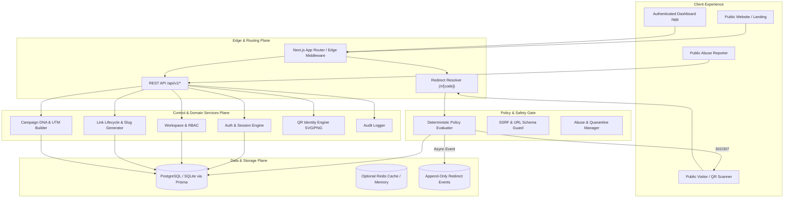

# LinkWay — Technical Architecture

**Document Version:** 1.0  
**Baseline:** LinkWeave Policy-Gated Edge Fabric Architecture & PRD v1.2  
**Date:** November 2026  

---

## 1. Architectural Philosophy

LinkWay is designed around the **LinkWeave Policy-Gated Edge Fabric**, which separates the high-velocity, latency-critical redirect path from the complex management and analytics control planes.

### Core Architectural Guarantees:
1. **Deterministic Redirect Decisions:** Short-link resolution is pure, deterministic, and isolated. Redirects never wait for analytics event persistence, AI copilot responses, or external reputation scans.
2. **Strict Anti-Open-Redirect Policy:** Short codes resolve exclusively to verified destinations stored in the database. Client query overrides (e.g. `?url=...`) are strictly prohibited.
3. **Workspace Isolation:** Tenancy boundaries are enforced server-side. Every data query is scoped by `workspaceId`.
4. **Append-Only Immutability:** Changes to link destinations generate immutable `LinkVersion` records. Rollbacks create new explicit versions rather than mutating the historical ledger.
5. **Truthful Event Capture:** Analytics captures *recorded redirect events* rather than inflated, unverified claims of unique humans.

---

## 2. System Plane Breakdown

---

## 3. Technology Stack Selection & Rationales

| Responsibility | Selected Technology | Rationale & Tradeoff Analysis |
|---|---|---|
| **Frontend Framework** | **Next.js 15 (App Router)** | Full-stack React 19 architecture providing Server Components for fast page loads and Client Components for rich interactive forms. |
| **Language** | **TypeScript (Strict Mode)** | End-to-end type safety across schemas, database queries, and client state, eliminating runtime contract mismatches. |
| **UI & Styling** | **Tailwind CSS** | Utility-first CSS configured with LinkWay brand design tokens (`#0B1430`, `#101B3B`, `#9636F5`, `#2458F5`, `#08C8E8`). |
| **Icons** | **Lucide React** | Modern, accessible, tree-shakable SVG icon set. |
| **Database & ORM** | **PostgreSQL (Neon) + Prisma ORM** | Neon provides serverless PostgreSQL with connection pooling. Prisma delivers robust type-safe database queries, schema migrations, and relational integrity. SQLite is supported for local zero-config testing. |
| **Validation** | **Zod** | Shared input validation schemas across server API routes and client forms. |
| **Authentication** | **Session-Based Cookie Auth (HMAC/JWT & Bcrypt)** | HttpOnly, SameSite, Secure cookie sessions with bcrypt password hashing. Avoids external vendor vendor-lockin while maintaining enterprise-grade session hygiene. |
| **QR Code Engine** | **`qrcode` Library** | Native server-side and browser rendering for sharp SVG vectors and high-resolution PNG downloads. |
| **Testing** | **Vitest** | Native ESM test runner with near-instant execution speed for unit and integration suites. |

---

## 4. Redirect Engine Execution Path

1. **Request Intake:** Visitor makes an `HTTP GET` request to `/r/[code]` or `/[code]`.
2. **Sanitization:** Normalize slug, reject invalid characters, check against reserved system paths.
3. **Lookup:** Fetch canonical `Link` record matching the code from cache or Prisma database.
4. **Policy Evaluation:**
   - If not found or status is `DELETED`: Return HTTP 404 Not Found.
   - If status is `PAUSED`: Return HTTP 410 Gone / Inactive Link Interstitial page.
   - If status is `ARCHIVED` or link has expired (`expiresAt < now()`): Return Expired Notice page.
   - If flagged by abuse policy or quarantined: Return HTTP 451 / 403 Safety Warning page.
   - If active & valid: Determine redirect code (default `302 Found` or `307 Temporary Redirect` to preserve POST semantics).
5. **Dispatch & Asynchronous Event Capture:**
   - Return redirect response immediately with `Cache-Control: private, no-store`.
   - In the background (non-blocking), insert a `RedirectEvent` record recording timestamp, referrer domain, coarse user-agent, device family, and anonymized geography.
